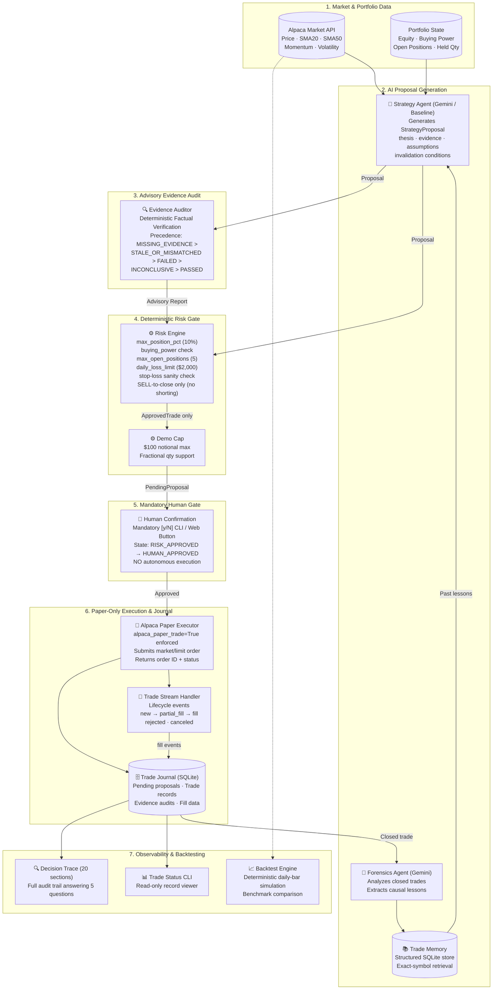

# TradePilot

> An accountable, explainable, human-in-the-loop AI trading assistant for Alpaca paper trading.

---

## Problem

Large language models can reason about markets, generate plausible-sounding theses, and propose trade actions — but they cannot be trusted to control execution directly. An LLM that directly submits orders:

- May hallucinate confidence, quantities, or risk parameters
- Has no deterministic risk enforcement
- Produces no audit trail explaining _why_ a trade was made
- Cannot be held accountable for what it approved
- Cannot learn from closed trades in a structured way

Letting an LLM "trade" without a safety boundary is not a system — it is a liability.

---

## Solution

TradePilot implements a **strict accountability architecture**. The LLM is a _proposal engine_, not an execution engine. Every step between market data and a filled order is deterministically controlled, logged, and explainable.

```
LLM proposes → Risk Engine validates → Human approves → Alpaca executes → Journal records → Forensics learns
```

No order touches Alpaca without passing all three gates: risk validation, demo cap enforcement, and explicit human confirmation.

---

## What Makes TradePilot Different

### 1. AI proposes. Deterministic code controls risk.

The `LLMStrategyAgent` generates a structured `TradeProposal` via Google Gemini with JSON-mode outputs enforced by a Pydantic schema. The proposal then passes through a purely deterministic `RiskEngine` that checks portfolio exposure, buying power, open position count, daily loss limits, and stop-loss sanity — independent of anything the LLM said.

### 2. Human approval is mandatory. Always.

A `[y/N]` confirmation prompt is shown at the terminal before any order is submitted. Autonomous trading is explicitly disabled. The paper-trading demo requires explicit human confirmation before submitting any order.

### 3. Actual Alpaca execution state is recorded.

The `TradeJournal` (SQLite) records the actual `alpaca_order_id`, `filled_quantity`, and `average_fill_price` returned by Alpaca — not values inferred from the original proposal. The `TradeStreamHandler` updates the journal from real Alpaca lifecycle events (`new`, `partial_fill`, `fill`, `rejected`, `canceled`).

### 4. Every trade has an explainable decision trace.

The `decision_trace` CLI produces a 19-section structured report for any trade, answering: why the trade was proposed, why risk approved it, who confirmed it, what Alpaca actually filled, and what the system has learned.

### 5. Closed trades produce forensic lessons and reusable memory.

The `ForensicsAgent` (Gemini-backed) compares the original thesis against actual outcomes for closed trades and produces a `TradeForensics` report. Lessons are stored as structured `TradeMemory` objects and fed back to the strategy agent on future trades.

---

## Architecture



> **Safety Invariant:** The LLM cannot execute orders, modify position sizes, or bypass the deterministic `RiskEngine`. Human approval is mandatory. `AlpacaPaperExecutor` strictly requires an `ApprovedTrade` instance generated by `RiskEngine` and confirmed by a human operator.

---

## Technology Stack

- **Runtime & Environment:** Python 3.12+, managed via `uv` (fast virtual environment & dependency management)
- **API Framework:** FastAPI, Uvicorn ASGI server
- **Validation & Schemas:** Pydantic v2 (`BaseModel`, `Field`, `model_validator`)
- **AI / LLM Integration:** Google GenAI SDK (`google-genai` targeting Gemini 3.6 Flash / structured JSON output)
- **Broker Integration:** Alpaca Trading SDK (`alpaca-py`, paper-trading endpoints only)
- **Data & Backtesting:** Pandas, NumPy
- **Persistence:** SQLite3 (standard library, zero-dependency, transactional journal and memory store)
- **Testing:** Pytest, AnyIO, FastAPI TestClient (Starlette)
- **Frontend Dashboard:** Vanilla HTML5, CSS3 (custom dark financial theme), Vanilla JavaScript (zero framework dependencies)

---

## Multi-Agent System

TradePilot uses two LLM-backed agents and several deterministic components. These are deliberately distinct.

| Component | Type | Role |
|---|---|---|
| `LLMStrategyAgent` | **AI (Gemini)** | Analyzes market snapshot + portfolio + past memories; generates a structured `TradeProposal` with thesis, confidence, assumptions, and invalidation conditions |
| `EvidenceAuditor` | **Deterministic** | Audits proposal factual claims against original `MarketSnapshot` and `PortfolioState`; classifies claims as SUPPORTED, UNSUPPORTED, or UNVERIFIABLE |
| `RiskEngine` | **Deterministic** | Enforces portfolio risk rules; the only component that produces an `ApprovedTrade` — required for execution |
| `AlpacaPaperExecutor` | **Deterministic** | Submits the order to Alpaca paper trading; reads back actual fill data |
| `TradeStreamHandler` | **Deterministic** | Maps Alpaca lifecycle events to `TradeRecord` state transitions; writes fill data to the journal |
| `ForensicsAgent` | **AI (Gemini)** | Activated only after a trade is confirmed closed; compares the original thesis against actual outcomes and produces a structured `TradeForensics` report |
| `MemoryStore` | **Deterministic** | Stores and retrieves `TradeMemory` objects from SQLite, ordered by evidence count and confidence |
| `BacktestEngine` | **Deterministic** | Daily-bar historical simulator testing baseline strategies with benchmark comparison |

The `RiskEngine` and `EvidenceAuditor` are intentionally not LLM components. Their evaluations are reproducible, auditable, and cannot be overridden by a model's output.

---

## Human Approval & Execution Lifecycle

TradePilot enforces an atomic 4-state lifecycle for every trade proposal:

```
[Proposal Created]
       │
       ▼
 1. RISK_APPROVED     → RiskEngine passed all checks; stored in pending_proposals; awaiting human decision.
       │
       ▼ (Explicit Human Confirmation via CLI [y/N] or Web Dashboard Button)
 2. HUMAN_APPROVED    → Operator explicitly confirmed trade; terms locked and immutable.
       │
       ▼ (Execution Triggered)
 3. EXECUTION_PENDING → Submitted to Alpaca Paper Trading; awaiting broker response/confirmation.
       │
       ▼ (Broker Confirms Order Fill/Rejection)
 4. EXECUTED          → Completed lifecycle; recorded in trade_records with actual fill data.
```

- **No Autonomous Execution:** No order is ever submitted to Alpaca without transitioning through `HUMAN_APPROVED`.
- **Re-validation on Approval:** If market snapshot or portfolio state changes between risk evaluation and human approval (e.g. price staleness > 5 min or buying power exhaustion), approval is rejected with HTTP 409 Conflict.
- **Atomic State Transitions:** Database updates use conditional SQL checks (`WHERE lifecycle_status = '...'`) preventing race conditions or duplicate order execution.

---

## Paper-Only Execution Boundary

- **Hard-coded Paper Configuration:** `alpaca_paper_trade: bool = True` is defined in `tradepilot/core/config.py`.
- **Client Factory Assertion:** `AlpacaPaperExecutor` asserts `settings.alpaca_paper_trade is True` at initialization. It raises a `ValueError` if set to `False`.
- **Paper Endpoint Isolation:** The executor explicitly initializes `TradingClient(..., paper=True)` connecting solely to `https://paper-api.alpaca.markets`.
- **Stable Client Order IDs:** Every submitted order binds `client_order_id = str(trade_id)`, ensuring idempotency and preventing duplicate submissions.
- **No Live Endpoints:** The live trading endpoint `https://api.alpaca.markets` is never referenced or accessible in the codebase.

---

## Explainable Decision Trace (20 Sections)

Run `uv run python -m tradepilot.decision_trace <TRADE_ID>` to generate a complete audit report for any trade in the journal.

The 20-section trace covers:

| # | Section | What it answers |
|---|---|---|
| 1 | Market Data / Evidence | What market conditions existed at proposal time |
| 2 | Strategy Decision | What action the AI proposed |
| 3 | Confidence | How confident the model was |
| 4 | Thesis | The AI's written reasoning |
| 5 | Assumptions | What had to be true for the trade to work |
| 6 | Invalidation Conditions | What would have proven the thesis wrong |
| 7 | Risk Decision | Whether the RiskEngine approved and why |
| 8 | Stop Price | Derived from invalidation conditions |
| 9 | Position Sizing (strategy proposal) | Qty at snapshot price |
| 10 | Demo Sizing ($100 cap) | How the cap was applied |
| 11 | Human Confirmation | Who approved execution |
| 12 | Client Order ID | TradePilot `trade_id` = Alpaca `client_order_id` |
| 13 | Alpaca Order ID | Alpaca's own UUID |
| 14 | Order Status | Live status from Alpaca |
| 15 | Submitted Quantity | Demo-capped qty sent to Alpaca |
| 16 | Execution Result | Actual filled qty, fill price, fill notional from Alpaca |
| 17 | Position / Outcome | Open or closed with entry/exit |
| 18 | Forensics Result | Pending (open) or lesson (closed) |
| 19 | Memory / Lesson | What the system learned and fed back |
| 20 | AI Decision Evidence Audit | Deterministic audit of factual claims vs snapshot/portfolio |

**The five questions the trace answers:**

- **Why did TradePilot make this trade?** → The AI's thesis (section 4)
- **Why was it allowed?** → RiskEngine verdict + demo cap (sections 7, 10)
- **Who approved it?** → Human operator at the terminal or dashboard (section 11)
- **What happened at Alpaca?** → Actual fill from the execution result (section 16)
- **What did the system learn?** → Forensics + memory (sections 18–19) and evidence audit (section 20)

**The five questions the trace answers:**

- **Why did TradePilot make this trade?** → The AI's thesis (section 4)
- **Why was it allowed?** → RiskEngine verdict + demo cap (sections 7, 10)
- **Who approved it?** → Human operator at the terminal (section 11)
- **What happened at Alpaca?** → Actual fill from the execution result (section 16)
- **What did the system learn?** → Forensics + memory (sections 18–19)

---

## Safety Architecture

| Rule | Implementation |
|---|---|
| **Paper trading only** | `alpaca_paper_trade: bool = True` in config; `AlpacaPaperExecutor` targets the Alpaca paper endpoint only |
| **ApprovedTrade boundary** | `executor.execute()` accepts only an `ApprovedTrade` — a type only `RiskEngine.evaluate()` can produce when status is `APPROVED` |
| **Deterministic risk checks** | Five independent checks: `max_position_pct`, `buying_power`, `max_open_positions`, `daily_loss_limit`, stop-loss direction |
| **$100 demo notional cap** | `apply_demo_sizing()` scales qty so `qty × price ≤ $100` before the order reaches the executor |
| **Human confirmation** | `input("[y/N]")` prompt in `paper_trade_demo.py`; `'n'` aborts with no order submitted |
| **BUY-to-open only** | `RiskEngine` rejects SELL if no long position is held for the symbol |
| **SELL-to-close only** | `RiskEngine` rejects SELL quantity exceeding held long position |
| **No autonomous trading** | No scheduler, no event loop, no automated trigger in any source file |
| **No live trading** | No live Alpaca endpoint is ever configured or called |

---

## Real Paper Trading Demonstration

TradePilot has executed one real paper trade on Alpaca during development.

| Field | Value |
|---|---|
| Symbol | PLTR |
| Action | BUY |
| Strategy | Bullish — price ($186.24) above SMA20 ($171.03) and SMA50 ($143.74), positive momentum |
| Requested qty | 0.5369 shares |
| Demo cap applied | $100.00 |
| Submitted qty | 0.5369 shares |
| **Actual filled qty** | **0.5369 shares** |
| **Actual fill price** | **$184.61** (Alpaca average fill) |
| **Fill notional** | **$99.12** |
| Snapshot price | $186.24 (market moved −$1.63 between proposal and fill) |
| Status | FILLED |
| Position | OPEN (not yet closed) |
| Client Order ID | `b6e16912-ee7e-47c6-a51b-a663064adaab` |
| Alpaca Order ID | `e3173016-c4fb-4208-ba0d-b99f425d417b` |
| Submitted at | 2026-08-31 13:23:01 UTC |

All fill values are sourced from Alpaca's order response — not inferred from the proposal.

> **No API keys or secrets appear in this repository. See `.env.example` for the required variable names.**

---

## Forensics and Memory

### Live PLTR Trade — Forensics Intentionally Pending

The PLTR position is currently **open**. Forensics only runs after a position is confirmed closed — specifically, after the Alpaca position quantity reaches zero and a real exit price is available. Until then, `decision_trace` correctly reports:

```
Position not yet closed -- forensics will run after exit is confirmed.
```

No lesson has been fabricated for PLTR.

### Offline Forensics Demo

A separate offline demonstration is available:

```bash
uv run python -m tradepilot.forensics_demo
```

This demo simulates a complete closed trade and shows the `ForensicsAgent` analyzing the outcome, extracting assumptions, and producing a structured lesson. It does not interact with the live journal or any Alpaca order.

### Memory Architecture

`TradeMemory` objects are stored in the same SQLite database (`data/tradepilot.db`). Retrieval is deterministic — ordered by evidence count then confidence — not by semantic vector similarity. This is an intentional MVP design choice documented under [Limitations](#limitations).

---

## Testing

```
329 tests passed, 2 warnings
```

The warnings are existing upstream deprecations in the `websockets` package (`websockets.legacy`) and `fastapi.testclient` (`httpx2`). Neither is introduced by TradePilot and neither affects functionality.

**Test coverage across all 24 test suites:**

| Test File | Subsystem & Verification Scope |
|---|---|
| `tests/test_risk_engine.py` | All deterministic risk checks: exposure %, buying power, max open positions, daily loss limit, stop-loss direction, SELL-to-close only |
| `tests/test_api_risk.py` | Deterministic `/api/risk/{symbol}` evaluation endpoint; verified isolated database fixture (no writes to live DB) |
| `tests/test_api_approval.py` | Human approval endpoint `/api/approve/{trade_id}`; atomic lifecycle transitions (`RISK_APPROVED` → `HUMAN_APPROVED`); stale snapshot re-validation |
| `tests/test_api_execution.py` | Paper execution endpoint `/api/execute/{trade_id}`; strict `ApprovedTrade` requirement; paper-only enforcement; idempotency and duplicate prevention |
| `tests/test_api_analyze.py` | Market analysis endpoint `/api/analyze/{symbol}`; server-side snapshot fetching; advisory-only constraints; error handling |
| `tests/test_api_journal.py` | Journal API endpoints; query trade records and pending proposals; serialization integrity |
| `tests/test_api_backtest.py` | Backtest API endpoint `/api/backtest`; parameter validation; symbol/date range/capital checks; isolation |
| `tests/test_api.py` | FastAPI application root; HTML dashboard serving; static asset mounting; DecisionTrace endpoint |
| `tests/test_evidence_auditor.py` | 33 comprehensive tests: EvidenceAuditor precedence (`MISSING_EVIDENCE > STALE_OR_MISMATCHED > FAILED > INCONCLUSIVE > PASSED`); factual claim vs qualitative assumption classification; `PendingProposal` support; indicator gap detection |
| `tests/test_decision_trace.py` | 20-section explainable DecisionTrace generation; lookup by `trade_id` or `alpaca_order_id`; section completeness |
| `tests/test_trace_status_consistency.py` | Cross-verification ensuring `trade_status`, `decision_trace`, and journal records agree on trade state and fills |
| `tests/test_trade_status.py` | Read-only trade status CLI and format validation |
| `tests/test_backtest_engine.py` | Deterministic daily-bar backtester; no look-ahead bias; stop-loss exits; buy-and-hold benchmark calculation |
| `tests/test_execution.py` | `AlpacaPaperExecutor` unit tests; lifecycle event mappings; fill accumulation; P&L calculation gating |
| `tests/test_paper_trade_demo.py` | Interactive demo sizing; $100 notional cap; fractional share calculations; market session checks |
| `tests/test_llm_strategy.py` | LLM strategy agent with mocked Gemini responses; Pydantic structured output validation; invalid field rejection |
| `tests/test_llm_retry.py` | LLM retry resilience; recovery from malformed model responses; schema enforcement |
| `tests/test_forensics.py` | Gemini-backed ForensicsAgent; thesis validation against closed trade outcomes; causal lesson generation |
| `tests/test_strategy.py` | Deterministic baseline strategy agent; moving average momentum calculations |
| `tests/test_market_data.py` | Market snapshot data fetching; technical indicator calculations; historical bar requests |
| `tests/test_alpaca_integration.py` | Alpaca client factory; paper-trading client configuration; credential validation |
| `tests/test_memory.py` | `TradeJournal` and `MemoryStore` SQLite persistence; exact-symbol retrieval prioritization |
| `tests/test_clock.py` | Market clock and session timing checks; regular vs extended hours handling |
| `tests/__init__.py` | Package initialization and test suite discovery |

---

## Project Structure

```
tradepilot/
├── agents/
│   ├── strategy.py          # Abstract StrategyAgent base class & deterministic baseline
│   ├── llm_strategy.py      # Google Gemini strategy agent (Pydantic structured output)
│   ├── evidence_auditor.py  # AI Decision Evidence Auditor (deterministic factual audit)
│   └── forensics.py         # Google Gemini forensics agent (closed trade analysis)
├── alpaca/
│   ├── client.py            # Alpaca client factory (enforces paper=True)
│   ├── execution.py         # AlpacaPaperExecutor (submits to paper trading endpoint)
│   ├── market_data.py       # Market snapshot fetcher (Alpaca Market Data API)
│   ├── portfolio.py         # Portfolio state fetcher (equity, buying power, positions)
│   ├── trade_stream.py      # Lifecycle event handler (fills, partial fills, cancellations)
│   └── clock.py             # Market session safety check
├── backtest/
│   ├── engine.py            # Deterministic daily-bar backtester (no look-ahead)
│   ├── portfolio.py         # Simulated portfolio state tracker
│   ├── models.py            # Backtest trade, equity curve, and benchmark models
│   └── data.py              # Historical daily bar data loader
├── core/
│   ├── models.py            # All canonical Pydantic data models & Enums
│   ├── risk_engine.py       # Deterministic RiskEngine (exposure, buying power, daily loss)
│   ├── sizing.py            # Position sizing & demo cap calculations
│   ├── orchestrator.py      # Legacy Step 1 prototype loop (preserved for reference)
│   └── config.py            # Settings (pydantic-settings / .env configuration)
├── memory/
│   ├── journal.py           # TradeJournal (SQLite: pending_proposals, trade_records, evidence_audits)
│   └── store.py             # MemoryStore (SQLite: structured TradeMemory episodic lessons)
├── web/
│   ├── index.html           # Single-page web dashboard layout
│   ├── style.css            # Dark financial UI styling
│   └── app.js               # Frontend controller (Market Watch, Journal, Backtesting, Trace)
├── api.py                   # FastAPI REST backend application
├── decision_trace.py        # 20-section explainable trace CLI
├── trade_status.py          # Read-only trade status CLI
├── paper_trade_demo.py      # Interactive terminal paper-trade demo
├── forensics_demo.py        # Offline forensics demonstration
├── ai_strategy_demo.py      # Standalone strategy agent demo
└── cli.py                   # Unified CLI entry point

tests/                       # 329 tests across 24 test suites
data/
└── tradepilot.db            # Local SQLite journal & memory store (gitignored, preserved locally)
```

---

## Setup

**Requirements:** Python 3.12+, [uv](https://github.com/astral-sh/uv)

```bash
# Clone and install
git clone <repo>
cd TradePilot
uv sync

# Configure credentials
cp .env.example .env
# Edit .env and fill in your values (see below)
```

**`.env` configuration:**

```env
# Alpaca paper trading credentials
# Get these from: https://app.alpaca.markets/paper-trading
ALPACA_API_KEY=your_alpaca_paper_api_key
ALPACA_SECRET_KEY=your_alpaca_paper_secret_key

# Google Gemini API key
# Get this from: https://aistudio.google.com/apikey
GEMINI_API_KEY=your_gemini_api_key

# Optional: override risk limits (defaults shown)
MAX_POSITION_PCT=0.1
MAX_RISK_USD=10000.0
MAX_OPEN_POSITIONS=5
DAILY_LOSS_LIMIT=2000.0
```

> Use Alpaca **paper trading** credentials only. Never configure live trading credentials.

**Run tests:**

```bash
uv run pytest
```

---

## Running the Application

### 1. Web Dashboard & Local REST API

TradePilot includes a single-page web dashboard backed by a FastAPI server:

```bash
# Launch the API and Web Dashboard (binds strictly to localhost)
uv run uvicorn tradepilot.api:app --host 127.0.0.1 --port 8000
```

Once running, navigate to:
```
http://127.0.0.1:8000
```

#### Local API Security Architecture
> **Important Security Requirement:**
> - The application is designed strictly for local single-operator use and binds to `127.0.0.1`.
> - **Do NOT bind to `0.0.0.0`** or deploy the application to a public network without a dedicated authentication and authorization proxy.
> - The API has **no built-in user authentication** or role-based access control. Endpoints such as `/api/approve/{trade_id}` and `/api/execute/{trade_id}` submit live paper orders directly to Alpaca. Exposing these endpoints to an untrusted network allows unauthorized parties to trigger paper trades.
> - Note that Cross-Origin Resource Sharing (CORS) is a browser security mechanism, **not** an authentication system.

---

### 2. Terminal CLI Tools & Demos

#### Interactive Paper Trade Demo
```bash
uv run python -m tradepilot.paper_trade_demo PLTR
```
This terminal workflow:
1. Fetches current market snapshot from Alpaca Market Data API
2. Fetches your paper portfolio state (equity, buying power, held quantities)
3. Retrieves stored episodic trade memories for the symbol
4. Generates an AI strategy proposal with thesis, assumptions, and invalidation triggers
5. Passes the proposal through the deterministic `RiskEngine`
6. Enforces the $100 demo notional cap (calculates exact fractional shares)
7. Prompts the human operator for mandatory confirmation: `[y/N]`
8. On `y`: submits the paper order to Alpaca and records the fill in `TradeJournal`

#### Read-Only Trade Status
```bash
uv run python -m tradepilot.trade_status <TRADE_ID>
# Example:
uv run python -m tradepilot.trade_status b6e16912-ee7e-47c6-a51b-a663064adaab
```
Displays trade ID, symbol, requested vs filled quantity, average fill price, execution status, Alpaca order ID, and entry timestamp. Realized P&L is displayed only when a trade is confirmed closed.

#### 20-Section Decision Trace
```bash
uv run python -m tradepilot.decision_trace <TRADE_ID>
```
Produces an exhaustive 20-section report verifying the end-to-end decision lifecycle: market evidence, thesis, assumptions, risk evaluation, human confirmation, Alpaca order IDs, fill data, forensics status, and AI Decision Evidence Audit.

#### Offline Forensics Demo
```bash
uv run python -m tradepilot.forensics_demo
```
Simulates a completed closed trade, demonstrating how the `ForensicsAgent` evaluates original hypotheses against actual market outcomes to extract structured lessons for `MemoryStore`.

---

## Backtesting Engine & Limitations

TradePilot provides a deterministic historical simulation engine (`tradepilot/backtest/engine.py`) designed to evaluate baseline strategies on completed historical daily bars:

### Backtesting Methodology
1. **Timing & Information Boundaries:**
   - **Bar $i$ Close:** The strategy observes completed bar data (closing price, volume, 20-day SMA, 50-day SMA, volatility) and evaluates entry conditions.
   - **Bar $i+1$ Open:** Simulated trade entries fill at the opening price of the next trading day. This guarantees **zero look-ahead bias** into the next day's close or future price movement.
2. **Exit Mechanics (Close-Based Stop Loss):**
   - At the close of each day while holding a position, if $\text{close}_i < \text{stop\_loss}$, an exit is scheduled.
   - The exit order fills at the opening price of bar $i+1$.
   - Positions open at the end of the simulation period remain explicitly marked as open; no hypothetical liquidation price is fabricated.
3. **Benchmark Comparison:**
   - Every backtest computes an exact buy-and-hold benchmark over the identical historical period, comparing total return, maximum drawdown, and Sharpe ratio.

### Backtesting Limitations & Disclaimer
- **Daily Bar Resolution:** The backtester models daily bar opens and closes. It does **not** simulate intraday tick data, intraday stop breaches, or bid-ask spread variations.
- **Slippage & Liquidity:** Simulated orders fill fully at the next bar's open without modeling market impact or partial fills.
- **Hypothetical Performance Disclaimer:**
  > **Historical backtesting is not proof or guarantee of future performance.** Simulated trading does not reflect actual financial risk, market liquidity crises, or unpredictable market behavior.

---

## Dashboard Views & Screenshots

The web dashboard provides real-time observability across the seven phases of the trading loop. Below are descriptions and step-by-step instructions for capturing screenshots:

### 1. Market Watch & Technical Snapshot
- **View Description:** Displays live market tickers (PLTR, NVDA, AAPL) with current price, day's change, volume, moving averages (SMA20, SMA50), and market session status.
- **Manual Capture Step:** Start the server (`uv run uvicorn tradepilot.api:app --host 127.0.0.1 --port 8000`), open `http://127.0.0.1:8000`, and capture the top "Market Watch" card.
- *Placeholder:* `[ Screenshot: Market Watch Card with live tickers, moving average metrics, and refresh timestamp ]`

### 2. AI Strategy Proposal & Evidence Auditor View
- **View Description:** Shows the Gemini Strategy Agent's thesis, structured confidence, forward-looking assumptions, invalidation conditions, and the deterministic Evidence Auditor badge (`PASSED`, `INCONCLUSIVE`, or `FAILED`).
- **Manual Capture Step:** In Market Watch, click on a symbol (e.g. `PLTR`) and click **"Analyze"**. Capture the "AI Strategy" card and the "AI Decision Evidence Auditor" verification table.
- *Placeholder:* `[ Screenshot: AI Strategy Proposal card showing thesis, stop-loss geometry, and Evidence Auditor verification table ]`

### 3. Deterministic Risk Evaluation & Sizing Gate
- **View Description:** Visualizes the deterministic `RiskEngine` verdict (`APPROVED` or `REJECTED`) with itemized rule checks (exposure percentage, buying power, daily loss limit, stop-loss sanity) and the $100 demo cap sizing.
- **Manual Capture Step:** After generating a proposal, click **"Evaluate Risk"**. Capture the "Risk Engine" card showing verified safety parameters.
- *Placeholder:* `[ Screenshot: Risk Engine evaluation card displaying rule breakdown, approved status, and demo-sized quantity ]`

### 4. Mandatory Human Approval & Paper Execution Gate
- **View Description:** Shows the pending proposal awaiting human action, the explicit `[Approve Trade]` button, and the subsequent `[Execute Paper Trade]` button.
- **Manual Capture Step:** With a risk-approved proposal active, capture the "Execution" card displaying the human confirmation prompt and paper-trading warning badges.
- *Placeholder:* `[ Screenshot: Human Approval interface showing pending proposal terms, approval button, and execution state ]`

### 5. Trade Journal & Lifecycle Ledger
- **View Description:** Comprehensive table displaying all stored trades, their lifecycle status (`RISK_APPROVED`, `HUMAN_APPROVED`, `EXECUTED`), order type, fill quantity, and average fill price.
- **Manual Capture Step:** Scroll to the "Trade Journal" section of the dashboard. Capture the table displaying past paper trades (including the recorded PLTR paper trade).
- *Placeholder:* `[ Screenshot: Trade Journal table showing historical trade records, execution statuses, and Alpaca order IDs ]`

### 6. Interactive Backtesting & Benchmark Comparison
- **View Description:** Input controls for symbol, date range, and starting capital, alongside summary cards (Total Return, Annualized Return, Max Drawdown, Win Rate), the buy-and-hold benchmark card, and the CSS equity curve chart.
- **Manual Capture Step:** Scroll to the "Backtesting" section, select `AAPL`, set dates from `2025-01-01` to `2026-01-01`, click **"Run Backtest"**, and capture the summary metrics and equity curve.
- *Placeholder:* `[ Screenshot: Backtesting results panel displaying equity curve chart, trade history table, and buy-and-hold benchmark ]`

---

## Three-Minute Manual Demo Walkthrough

Follow this scripted 3-minute sequence to demonstrate the entire TradePilot architecture to reviewers:

```
[00:00 - 00:30] System Overview & Architecture
1. Open terminal and run:
   uv run uvicorn tradepilot.api:app --host 127.0.0.1 --port 8000
2. Open browser at http://127.0.0.1:8000.
3. Highlight the core principle: "AI proposes. Risk controls. Human approves. Alpaca executes. The system records."
4. Point out the top badges: "PAPER TRADING" (active) and "LIVE TRADING DISABLED" (enforced).

[00:30 - 01:15] Market Analysis, AI Proposal & Evidence Audit
5. In Market Watch, click "PLTR". Review the market snapshot (Price, SMA20, SMA50, Momentum).
6. Click "Analyze". The Gemini agent generates a structured TradeProposal (thesis, assumptions, invalidation triggers).
7. Review the AI Decision Evidence Auditor card: point out that the auditor deterministically cross-checks
   every factual claim against the original market snapshot.

[01:15 - 01:45] Deterministic Risk Engine & Sizing Gate
8. Click "Evaluate Risk". The RiskEngine validates the 5 deterministic rules:
   exposure <= 10%, buying power >= cost, position count <= 5, daily loss limit unbreached, stop-loss sanity.
9. Note that the $100 demo cap automatically sizes the trade to fractional shares, preventing outsized orders.

[01:45 - 02:15] Mandatory Human Approval & Paper Execution
10. Show the pending proposal: emphasize that NO order has been sent to Alpaca. Autonomous trading is impossible.
11. Click "Approve Trade": the state transitions atomically from RISK_APPROVED to HUMAN_APPROVED.
12. Click "Execute Paper Trade": AlpacaPaperExecutor submits the order to the paper endpoint.
13. View the Trade Journal table update in real time with the confirmed fill quantity and fill price.

[02:15 - 02:45] 20-Section Decision Trace Observability
14. Click on the executed trade row in the Trade Journal, then click "View Decision Trace".
15. Scroll through the 20-section trace: highlight Section 4 (AI thesis), Section 7 (Risk verdict),
    Section 11 (Human confirmation), Section 16 (Actual Alpaca fill), and Section 20 (Evidence audit).

[02:45 - 03:00] Deterministic Historical Backtesting
16. Scroll to the "Backtesting" card. Enter AAPL, set dates 2025-01-01 to 2026-01-01, capital $10,000.
17. Click "Run Backtest". Review the instant deterministic simulation: trade log, equity curve,
    and buy-and-hold benchmark comparison.
```

---

## Known Limitations

- **Paper Trading Only:** Targets exclusively the Alpaca paper trading API. Live-money trading is strictly disabled.
- **Single-User Architecture:** Designed as an engineer's portfolio project and personal trading assistant. It does not provide multi-user tenancy, session authentication, or commercial SaaS billing.
- **Daily Bar Granularity:** Strategy generation and backtesting operate on completed daily bars. Intraday tick-by-tick simulation and order book depth are not modeled.
- **Probabilistic AI Outputs:** Strategy proposals and forensics lessons are generated by large language models. While constrained by deterministic risk checks and evidence auditing, model suggestions remain probabilistic and advisory.
- **No Autonomous Execution:** Human confirmation is architecturally mandatory. There is no automated cron, webhook, or background execution worker.

---

## Disclaimer

TradePilot is an **educational and portfolio software engineering project**.

- It uses **Alpaca paper trading only**. No real money is involved.
- It is **not financial advice** and makes no claim of profitability or trading edge.
- It is **not commercial or production-grade trading infrastructure**.
- Past performance and historical backtest results are **not predictive of future market returns**.
- Do not configure or connect this software with live brokerage trading credentials.
