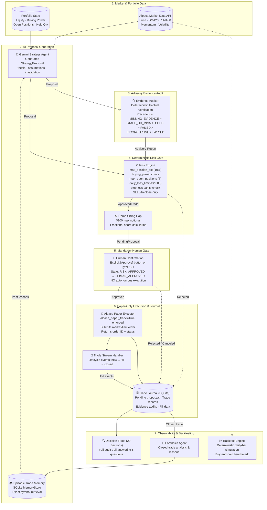

# TradePilot

> An accountable, explainable, human-in-the-loop AI trading assistant and backtesting platform for Alpaca paper trading.

[](https://www.python.org/)
[](https://fastapi.tiangolo.com/)
[](https://docs.pydantic.dev/)
[](https://alpaca.markets/)
[](tests/)
[](LICENSE)

---

## 1. Project Introduction

TradePilot is an engineering portfolio project demonstrating an **accountable, human-in-the-loop AI architecture** applied to algorithmic paper trading and historical strategy backtesting.

Large language models (LLMs) can reason about market context and synthesize analytical theses, but they cannot be trusted with autonomous execution. Unchecked AI systems risk hallucinating quantities, disregarding portfolio limits, failing to provide audit trails, and operating without accountability.

TradePilot solves this by enforcing a strict separation of concerns governed by one core architectural principle:

> **AI proposes. Risk controls. Human approves. Alpaca paper-executes. The system records and learns.**

### Portfolio Purpose & Operational Boundaries
- **Educational & Portfolio Prototype:** TradePilot is designed as a technical demonstration of resilient AI orchestration, deterministic validation barriers, and explainable observability.
- **Not an Autonomous Trading Bot:** TradePilot contains no automated trading loops, schedulers, or background workers. Every order proposal halts until an operator explicitly approves it.
- **Paper Trading Exclusively:** The codebase is hard-coded to Alpaca's paper-trading sandbox. Live brokerage endpoints are strictly disabled.
- **Not Financial Advice:** TradePilot makes no claims of alpha generation, market profitability, or suitability for live capital.

---

## 2. Key Features

- **AI Strategy Proposal Engine:** Uses Google Gemini (`gemini-3.6-flash`) with structured JSON schemas (`tradepilot/agents/llm_strategy.py`) to formulate hypotheses, confidence scores, forward-looking assumptions, and quantitative invalidation levels.
- **Deterministic Evidence Auditor:** A rules-based verification engine (`tradepilot/agents/evidence_auditor.py`) that cross-checks the AI's factual claims against verified market snapshots and portfolio metrics before execution.
- **Deterministic Risk Engine:** A mathematical safety boundary (`tradepilot/core/risk_engine.py`) that enforces 5 non-negotiable risk rules (exposure percentage, buying power, open positions, daily loss ceiling, and stop-loss sanity) completely independent of AI confidence.
- **Mandatory Human Approval Gate:** Two-step approval/execution workflow (`tradepilot/api.py`). Trades transition from `RISK_APPROVED` to `HUMAN_APPROVED` only after explicit confirmation via Web UI or CLI.
- **Enforced Paper-Only Execution:** Hard-coded configuration (`alpaca_paper_trade = True`) targeting `https://paper-api.alpaca.markets`. Live trading URLs are physically absent from the executor.
- **Transactional Trade Journal & Episodic Memory:** Stores end-to-end proposal lifecycles, execution fills, and evidence audits in SQLite (`tradepilot/memory/journal.py`). Closed-trade lessons are persisted in `MemoryStore` (`tradepilot/memory/store.py`) to inform future strategy prompts.
- **20-Section Explainable DecisionTrace:** A comprehensive audit report CLI and API endpoint (`tradepilot/decision_trace.py`) answering: *Why was the trade proposed? Why did risk approve it? Who confirmed it? What actually filled? What did the system learn? Was the evidence verified?*
- **Closed-Trade Forensics Agent:** An automated post-trade analysis agent (`tradepilot/agents/forensics.py`) that compares initial theses against realized outcomes once positions close, distilling causal takeaways.
- **Deterministic Historical Backtester:** A daily-bar backtesting engine (`tradepilot/backtest/engine.py`) featuring zero look-ahead bias (evaluates at bar $i$ close, executes at bar $i+1$ open), stop-loss exits, and automated buy-and-hold benchmark comparisons.

---

## 3. Architecture

TradePilot isolates probabilistic AI reasoning from deterministic safety controls and execution boundaries.



### Component Responsibility Matrix

| Component | Subsystem | Type | Function | Source File |
|---|---|---|---|---|
| `LLMStrategyAgent` | Strategy | **Probabilistic (AI)** | Analyzes market snapshot + portfolio + memories to formulate structured proposal | [`tradepilot/agents/llm_strategy.py`](tradepilot/agents/llm_strategy.py) |
| `EvidenceAuditor` | Audit | **Deterministic** | Audits factual claims against snapshot; generates severity-ranked audit report | [`tradepilot/agents/evidence_auditor.py`](tradepilot/agents/evidence_auditor.py) |
| `RiskEngine` | Safety | **Deterministic** | Validates portfolio risk limits; exclusively creates `ApprovedTrade` | [`tradepilot/core/risk_engine.py`](tradepilot/core/risk_engine.py) |
| `apply_demo_sizing` | Safety | **Deterministic** | Caps trade notional value to $100 and computes fractional quantities | [`tradepilot/core/sizing.py`](tradepilot/core/sizing.py) |
| `AlpacaPaperExecutor` | Execution | **Deterministic** | Submits orders strictly to Alpaca paper endpoint; records actual fills | [`tradepilot/alpaca/execution.py`](tradepilot/alpaca/execution.py) |
| `TradeStreamHandler` | Execution | **Deterministic** | Streams broker execution states (`fill`, `partial_fill`, `canceled`) into journal | [`tradepilot/alpaca/trade_stream.py`](tradepilot/alpaca/trade_stream.py) |
| `TradeJournal` | Persistence | **Deterministic** | SQLite transactional storage for proposals, trade records, and audits | [`tradepilot/memory/journal.py`](tradepilot/memory/journal.py) |
| `MemoryStore` | Memory | **Deterministic** | Stores episodic trade lessons; exact-symbol ranking by confidence and evidence | [`tradepilot/memory/store.py`](tradepilot/memory/store.py) |
| `ForensicsAgent` | Learning | **Probabilistic (AI)** | Evaluates closed trade outcomes against initial thesis to extract lessons | [`tradepilot/agents/forensics.py`](tradepilot/agents/forensics.py) |
| `BacktestEngine` | Simulation | **Deterministic** | Daily-bar simulator with zero look-ahead bias and benchmark comparison | [`tradepilot/backtest/engine.py`](tradepilot/backtest/engine.py) |

---

## 4. How It Works (7-Step Proposal Lifecycle)

Every trading opportunity progresses through an atomic 7-step lifecycle:

```
[1. Market Ingestion] ──► [2. Strategy Proposal] ──► [3. Evidence Audit]
                                                              │
                                                              ▼
[6. Paper Execution] ◄── [5. Human Approval] ◄── [4. Risk Evaluation]
         │
         ▼
[7. Journal, DecisionTrace & Forensics]
```

1. **Market & Portfolio Data Ingestion:**
   The system fetches real-time bar metrics (latest price, 20-day SMA, 50-day SMA, momentum, volatility) from Alpaca Market Data and account metrics (equity, cash, buying power, open positions) from the Alpaca Trading API.
2. **Strategy Proposal Generation:**
   The `LLMStrategyAgent` evaluates the market snapshot alongside past trade memories retrieved from `MemoryStore`. It produces a validated `StrategyProposal` containing the proposed action (`BUY`, `SELL`, `NO_TRADE`), thesis, confidence score, quantitative assumptions, and invalidation stop levels.
3. **Advisory Evidence Audit:**
   The `EvidenceAuditor` cross-references all factual claims made in the thesis against the ingested `MarketSnapshot`. Claims are tagged as `SUPPORTED`, `UNSUPPORTED`, or `UNVERIFIABLE`. The overall audit status is calculated with strict precedence: `MISSING_EVIDENCE` > `STALE_OR_MISMATCHED` > `FAILED` > `INCONCLUSIVE` > `PASSED`.
4. **Deterministic Risk Evaluation & Sizing:**
   The `RiskEngine` independently checks the proposal against 5 deterministic rules. If passed, the engine returns an `ApprovedTrade`. The demo sizing layer then scales the position to satisfy the $100 notional cap (`MAX_DEMO_ORDER_NOTIONAL`). The proposal is saved to the SQLite `pending_proposals` table with status **`RISK_APPROVED`**.
5. **Mandatory Human Gate:**
   The proposal is presented to the human operator via the Web Dashboard or terminal prompt. The operator reviews the AI thesis, the Evidence Audit report, and the risk sizing. Execution cannot proceed without explicit operator confirmation, transitioning the state to **`HUMAN_APPROVED`**.
6. **Paper-Only Execution:**
   The execution request transitions the proposal state to **`EXECUTION_PENDING`**. `AlpacaPaperExecutor` submits the order to `https://paper-api.alpaca.markets`. Upon broker confirmation, the proposal state transitions to **`EXECUTED`**, and a permanent `TradeRecord` is created in SQLite with the actual filled quantity and average fill price.
7. **Observability, Journaling & Closed-Trade Forensics:**
   The trade is immediately inspectable via the 20-section `DecisionTrace`. Once Alpaca confirms that the position is closed, the `ForensicsAgent` compares the final realized P&L against the initial hypothesis, distilling an episodic lesson that is written to `MemoryStore` to guide future decisions.

### Lifecycle State Machine

| Pre-Execution State | Trigger / Condition | Transition Gate |
|---|---|---|
| `RISK_APPROVED` | `RiskEngine.evaluate()` passes all 5 rules; demo cap applied | Stored in `pending_proposals`; awaits human decision |
| `HUMAN_APPROVED` | Operator clicks **Approve** in UI or inputs `y` in CLI | Re-verifies price freshness (< 5 min); locks trade terms |
| `EXECUTION_PENDING` | Order payload submitted to `AlpacaPaperExecutor` | Awaits Alpaca paper API acknowledgement |
| `EXECUTED` | Broker confirms order placement and returns order ID | Fill data recorded in `trade_records`; lifecycle completed |

---

## 5. Technology Stack

| Layer | Technology | Version | Purpose |
|---|---|---|---|
| **Runtime & Tooling** | Python | 3.12+ | Core runtime environment |
| **Package Management** | `uv` | Latest | High-speed virtual environment and dependency manager |
| **Backend Framework** | FastAPI | 0.115+ | High-performance asynchronous REST API server |
| **ASGI Server** | Uvicorn | Standard | Local production-grade ASGI server |
| **Validation & Modeling**| Pydantic | v2.10+ | Schema validation, type safety, and JSON model serialization |
| **AI / LLM Integration** | Google GenAI SDK | `google-genai` | Gemini 3.6 Flash structured proposal & forensics generation |
| **Broker Integration** | Alpaca-py SDK | `alpaca-py` | Paper trading order submission, account state, and market data |
| **Data & Analytics** | Pandas / NumPy | 2.2+ / 2.1+ | Historical daily bar simulation, indicators, and metrics |
| **Persistence** | SQLite3 | Python stdlib | Embedded ACID transactional journal and memory storage |
| **Testing Framework** | Pytest / AnyIO | 8.3+ / 4.8+ | Unit, integration, and asynchronous test runner |
| **Frontend UI** | HTML5 / CSS3 / JavaScript | Vanilla | Zero-dependency, responsive dark financial dashboard |

---

## 6. Project Structure

```
TradePilot/
├── tradepilot/
│   ├── agents/
│   │   ├── strategy.py          # Abstract StrategyAgent base & baseline momentum strategy
│   │   ├── llm_strategy.py      # Google Gemini strategy agent (structured JSON output)
│   │   ├── evidence_auditor.py  # Deterministic factual evidence auditor & precedence logic
│   │   └── forensics.py         # Google Gemini forensics agent for closed trade analysis
│   ├── alpaca/
│   │   ├── client.py            # Alpaca SDK factory (hard-codes paper=True)
│   │   ├── execution.py         # AlpacaPaperExecutor (order submission & fill ingestion)
│   │   ├── market_data.py       # Technical indicator calculation & Alpaca data fetcher
│   │   ├── portfolio.py         # Account state fetcher (equity, buying power, positions)
│   │   ├── trade_stream.py      # Websocket lifecycle event handler (fills, partial fills)
│   │   └── clock.py             # Market session and trading hours validation
│   ├── backtest/
│   │   ├── engine.py            # Daily-bar simulation engine (zero look-ahead bias)
│   │   ├── portfolio.py         # Simulated backtest portfolio and position ledger
│   │   ├── models.py            # Backtest trades, equity curve, and benchmark schemas
│   │   └── data.py              # Historical daily bar data loader
│   ├── core/
│   │   ├── models.py            # Canonical Pydantic schemas, Enums, and lifecycle states
│   │   ├── risk_engine.py       # Deterministic RiskEngine (5 mathematical safety rules)
│   │   ├── sizing.py            # Position sizing & $100 demo notional cap calculation
│   │   ├── orchestrator.py      # Legacy prototype loop (preserved for reference)
│   │   └── config.py            # Application settings (pydantic-settings / .env loader)
│   ├── memory/
│   │   ├── journal.py           # TradeJournal (SQLite: pending proposals, trades, audits)
│   │   └── store.py             # MemoryStore (SQLite: episodic trade memories & lessons)
│   ├── web/
│   │   ├── index.html           # Single-page web dashboard layout
│   │   ├── style.css            # Dark financial UI styling and responsive layouts
│   │   └── app.js               # Frontend controller (Market Watch, Journal, Backtesting)
│   ├── api.py                   # FastAPI application root and REST endpoints
│   ├── decision_trace.py        # 20-Section Explainable DecisionTrace CLI
│   ├── trade_status.py          # Read-only trade status CLI viewer
│   ├── paper_trade_demo.py      # Interactive terminal paper-trade demo with [y/N] prompt
│   ├── forensics_demo.py        # Offline closed-trade forensics demonstration
│   ├── ai_strategy_demo.py      # Standalone AI strategy generation CLI
│   └── cli.py                   # Unified CLI entrypoint
├── tests/                       # 24 test suites (328 passed, 1 skipped)
├── data/
│   └── tradepilot.db            # Local SQLite database (journal & memory store)
├── .env.example                 # Template for environment configuration
├── pyproject.toml               # Project metadata and dependencies (uv)
└── README.md                    # Project documentation
```

---

## 7. Installation & Setup

TradePilot is packaged and managed with [`uv`](https://github.com/astral-sh/uv) for fast, reproducible environment setup on Windows, macOS, and Linux.

### 1. Prerequisites
- **Python 3.12+**
- **uv:** Install via PowerShell on Windows:
  ```powershell
  powershell -ExecutionPolicy ByPass -c "irm https://astral.sh/uv/install.ps1 | iex"
  ```
  Or via curl on Linux/macOS:
  ```bash
  curl -LsSf https://astral.sh/uv/install.sh | sh
  ```

### 2. Clone and Install Dependencies
```bash
git clone https://github.com/your-username/TradePilot.git
cd TradePilot

# Create virtual environment and install exact locked dependencies
uv sync
```

### 3. Configure Environment Variables
Copy `.env.example` to create your local `.env` file:

```bash
# Windows PowerShell
copy .env.example .env

# Linux / macOS
cp .env.example .env
```

Open `.env` in an editor and supply your API keys:

```ini
# Alpaca Paper Trading Credentials (https://app.alpaca.markets/paper-trading)
ALPACA_API_KEY=your_alpaca_paper_api_key_here
ALPACA_SECRET_KEY=your_alpaca_paper_secret_key_here
ALPACA_PAPER_TRADE=True

# Google Gemini API Key (https://aistudio.google.com/apikey)
GEMINI_API_KEY=your_gemini_api_key_here
GEMINI_MODEL_NAME=gemini-3.6-flash

# Deterministic Risk Limits (optional overrides; defaults shown)
MAX_POSITION_PCT=0.1
MAX_RISK_USD=10000.0
MAX_OPEN_POSITIONS=5
DAILY_LOSS_LIMIT=2000.0
MAX_DEMO_ORDER_NOTIONAL=100.00
```

> **Security Warning:** Never place live brokerage API credentials into `.env`. TradePilot is strictly designed for Alpaca Paper Trading.

---

## 8. Running the Application

### 1. Web Dashboard & Local REST API
Launch the backend server and single-page dashboard:

```bash
uv run uvicorn tradepilot.api:app --host 127.0.0.1 --port 8000
```

Once started, open your web browser to:
```
http://127.0.0.1:8000
```

> **Localhost Network Requirement:**
> The API binds strictly to `127.0.0.1`. Do not bind to `0.0.0.0` or expose the service over a public network. The API contains no authentication layer; exposing it allows unauthorized parties on your network to trigger paper trades.

### 2. Command-Line Tools & Demos

#### Interactive Paper Trade Demo (Terminal Prompt)
Run a complete trade generation and confirmation loop directly in your console:
```bash
uv run python -m tradepilot.paper_trade_demo PLTR
```
This fetches the current market snapshot, generates an AI proposal, validates it against the `RiskEngine`, applies the $100 demo cap, and prompts the operator with `[y/N]`. Entering `y` submits the paper order to Alpaca.

#### Read-Only Trade Status Viewer
Inspect the execution state and fill details of any recorded trade:
```bash
uv run python -m tradepilot.trade_status <TRADE_ID>
# Example:
uv run python -m tradepilot.trade_status b6e16912-ee7e-47c6-a51b-a663064adaab
```

#### 20-Section Explainable Decision Trace
Generate a comprehensive 20-section audit report for any trade:
```bash
uv run python -m tradepilot.decision_trace <TRADE_ID_OR_ALPACA_ORDER_ID>
```
The trace details market evidence, strategy thesis, assumptions, invalidation conditions, risk engine checks, human confirmation, actual Alpaca fill data, forensics analysis, episodic memories, and the AI Decision Evidence Audit.

#### Offline Forensics Demo
Simulate a closed trade outcome and observe how the `ForensicsAgent` derives causal lessons:
```bash
uv run python -m tradepilot.forensics_demo
```

#### Standalone AI Strategy Generation
Generate and display a structured Gemini strategy proposal without evaluating risk or executing:
```bash
uv run python -m tradepilot.ai_strategy_demo NVDA
```

---

## 9. Safety & Risk Controls

TradePilot's safety model is built on deterministic code boundaries that cannot be bypassed by LLM prompts.

### Deterministic Risk Rules (`RiskEngine`)

The `RiskEngine` (`tradepilot/core/risk_engine.py`) evaluates every proposal against five mathematical constraints:

1. **Maximum Position Exposure (`MAX_POSITION_PCT = 0.1`):**
   No single position's total notional value may exceed 10% of total portfolio equity.
2. **Maximum Dollar Risk (`MAX_RISK_USD = 10000.0`):**
   The maximum capital placed at risk per trade (defined by position size multiplied by distance to stop loss) cannot exceed $10,000.
3. **Maximum Concurrent Open Positions (`MAX_OPEN_POSITIONS = 5`):**
   If the portfolio already holds 5 open positions, any new BUY proposal is automatically rejected.
4. **Daily Loss Ceiling (`DAILY_LOSS_LIMIT = 2000.0`):**
   If cumulative realized portfolio losses on the current trading day reach or exceed $2,000, all trading is halted.
5. **Stop-Loss Directional Sanity:**
   - A `BUY` proposal must have a stop loss strictly **below** the entry price.
   - A `SELL` proposal must have a stop loss strictly **above** the entry price.
6. **No Short Selling (Long-Only Architecture):**
   - `BUY` is permitted only to open or add to a long position.
   - `SELL` is permitted only to reduce or close an existing long position. Selling more shares than currently held is rejected.

### Additional Safety Boundaries
- **$100 Demo Sizing Cap (`MAX_DEMO_ORDER_NOTIONAL = 100.00`):**
  Interactive demos scale share quantities down to fractional amounts so total notional exposure never exceeds $100 per demo trade.
- **Mandatory Human Confirmation:**
  The `AlpacaPaperExecutor` accepts only an `ApprovedTrade` object that has transitioned through `HUMAN_APPROVED`. There is no automated or programmatic override.
- **Paper Trading Boundary:**
  `AlpacaPaperExecutor` asserts `settings.alpaca_paper_trade is True`. If set to `False`, initialization fails with `ValueError`. Live endpoints (`https://api.alpaca.markets`) do not exist anywhere in the execution code.

---

## 10. Backtesting Engine & Limitations

TradePilot includes a deterministic historical backtesting engine (`tradepilot/backtest/engine.py`) designed to evaluate baseline trading strategies against historical daily bar data.

### Simulation Methodology
1. **Zero Look-Ahead Bias:**
   - **Bar $i$ Close:** The strategy observes completed bar data (closing price, volume, 20-day SMA, 50-day SMA, volatility) and evaluates entry conditions.
   - **Bar $i+1$ Open:** Simulated entries execute strictly at the opening price of the next trading day. The simulation never uses next-day highs, lows, or closes for entry decisions.
2. **Close-Based Stop-Loss Exit:**
   - At the close of each day while holding a position, if $\text{close}_i < \text{stop\_loss}$, an exit is scheduled.
   - The exit order fills at the opening price of bar $i+1$.
   - Positions open at the end of the simulation period remain explicitly marked as open; no hypothetical liquidation price is fabricated.
3. **Automated Buy-and-Hold Benchmark:**
   - Every backtest calculates an identical buy-and-hold benchmark for the target symbol across the exact same historical date window, comparing total return, maximum drawdown, and Sharpe ratio.

### Limitations & Hypothetical Performance Disclaimer
- **Daily Bar Resolution:** The backtester models daily bar opens and closes. It does **not** model intraday tick data, intraday stop breaches, or bid-ask spread variations.
- **Slippage & Market Impact:** Simulated orders fill at the exact opening bar price without modeling market impact or partial fills.
- **Disclaimer:**
  > **Historical backtesting is not proof or guarantee of future performance.** Simulated trading does not reflect actual financial risk, market liquidity crises, or unpredictable market behavior.

---

## 11. Testing & Verification

TradePilot includes a comprehensive test suite of 24 test files verifying every subsystem in complete isolation.

### Test Results

```
========================= 328 passed, 1 skipped, 2 warnings in 29.82s =========================
```

- **328 Passed:** Full coverage across API endpoints, risk engine boundaries, Pydantic schemas, sizing caps, evidence audit logic, forensics, and backtesting.
- **1 Skipped:** `tests/test_market_data.py::test_fetch_market_snapshot_integration` was skipped due to an external network timeout reaching `data.alpaca.markets:443` in restricted network environments.
- **2 Deprecation Warnings:** Upstream third-party warnings from `websockets.legacy` and Starlette `httpx2`. Neither originates from TradePilot code.

### Test Suite Breakdown

| Test File | Verification Scope |
|---|---|
| `tests/test_risk_engine.py` | Deterministic risk limits (exposure %, buying power, position count, daily loss, stop direction) |
| `tests/test_api_risk.py` | API `/api/risk/{symbol}` evaluation; verified isolated database fixture (no writes to live DB) |
| `tests/test_api_approval.py` | Human approval endpoint `/api/approve/{trade_id}`; atomic lifecycle state transitions |
| `tests/test_api_execution.py` | Paper execution endpoint `/api/execute/{trade_id}`; paper-only enforcement; idempotency |
| `tests/test_api_analyze.py` | Market analysis endpoint `/api/analyze/{symbol}`; server-side snapshot fetching |
| `tests/test_api_journal.py` | Journal API endpoints; query trade records and pending proposals; serialization integrity |
| `tests/test_api_backtest.py` | Backtest API endpoint `/api/backtest`; parameter validation; symbol/date range/capital checks |
| `tests/test_api.py` | FastAPI application root; HTML dashboard serving; static asset mounting |
| `tests/test_evidence_auditor.py` | 33 tests verifying EvidenceAuditor precedence, factual claim parsing, and `PendingProposal` support |
| `tests/test_decision_trace.py` | 20-Section explainable DecisionTrace generation; lookup by `trade_id` or `alpaca_order_id` |
| `tests/test_trace_status_consistency.py` | Cross-verification ensuring `trade_status`, `decision_trace`, and journal records agree |
| `tests/test_trade_status.py` | Read-only trade status CLI formatting and exit code checks |
| `tests/test_backtest_engine.py` | Deterministic daily-bar backtester; zero look-ahead bias; stop-loss exits; benchmark calculations |
| `tests/test_execution.py` | `AlpacaPaperExecutor` unit tests; lifecycle event mappings; fill accumulation |
| `tests/test_paper_trade_demo.py` | Interactive demo sizing; $100 notional cap; fractional share calculations; session checks |
| `tests/test_llm_strategy.py` | LLM strategy agent with mocked Gemini responses; Pydantic structured output validation |
| `tests/test_llm_retry.py` | LLM retry resilience; recovery from malformed model responses; schema enforcement |
| `tests/test_forensics.py` | ForensicsAgent evaluation of closed trades; causal lesson generation |
| `tests/test_strategy.py` | Deterministic baseline strategy agent; moving average momentum calculations |
| `tests/test_market_data.py` | Market snapshot data fetching; technical indicator calculations; historical bar requests |
| `tests/test_alpaca_integration.py` | Alpaca client factory; paper-trading configuration; credential validation |
| `tests/test_memory.py` | `TradeJournal` and `MemoryStore` SQLite persistence; exact-symbol retrieval prioritization |
| `tests/test_clock.py` | Market session timing checks; regular vs extended hours handling |
| `tests/__init__.py` | Package discovery and root configuration |

> **Database Isolation Notice:** All test suites that interact with SQLite use temporary databases created via `tmp_path` fixtures. The live journal database (`data/tradepilot.db`) is never modified during test execution.

---

## 12. Security Limitations

Reviewers evaluating TradePilot should be aware of the following security characteristics:

- **Single-User Architecture:** TradePilot is designed as a single-operator local application. It has no user login, multi-tenancy, or role-based access control (RBAC).
- **Unauthenticated REST API:** Endpoints such as `/api/approve/{trade_id}` and `/api/execute/{trade_id}` do not require authentication tokens.
- **Localhost Binding Only:** Uvicorn must be bound strictly to `127.0.0.1`. Binding to `0.0.0.0` or exposing the port through a router exposes paper execution controls to the local network.
- **Paper Trading Only:** The application does not support, and must not be used for, live brokerage accounts.
- **Local SQLite Persistence:** The database is stored locally at `data/tradepilot.db`. It is not designed for distributed, concurrent write access.
- **No Production Deployment:** This repository is not designed for public cloud deployment without a dedicated authentication gateway and reverse proxy.

---

## 13. Three-Minute Manual Demo Walkthrough

Reviewers can follow this scripted 3-minute sequence to demonstrate the entire system end-to-end:

```
[00:00 - 00:30] System Startup & Architecture Overview
1. Open terminal and run:
   uv run uvicorn tradepilot.api:app --host 127.0.0.1 --port 8000
2. Open browser at http://127.0.0.1:8000.
3. Review the top status bar: "PAPER TRADING" (active) and "LIVE TRADING DISABLED" (enforced).
4. Explain the core principle: "AI proposes. Risk controls. Human approves. Alpaca executes."

[00:30 - 01:15] Market Ingestion, AI Strategy Proposal & Evidence Audit
5. In Market Watch, select "PLTR". Review technical indicators (Price, SMA20, SMA50, Momentum).
6. Click "Analyze". The Gemini agent generates a structured TradeProposal (thesis, assumptions, invalidation triggers).
7. Review the "AI Decision Evidence Auditor" table: highlight that the auditor deterministically cross-checks
   every factual assertion in the thesis against the ingested market snapshot.

[01:15 - 01:45] Deterministic Risk Engine & Sizing Gate
8. Click "Evaluate Risk". The RiskEngine validates the 5 deterministic rules:
   exposure <= 10%, buying power >= cost, position count <= 5, daily loss limit unbreached, stop-loss sanity.
9. Note that the $100 demo cap automatically sizes the trade to fractional shares, preventing outsized orders.

[01:45 - 02:15] Mandatory Human Approval & Paper Execution
10. Highlight the pending proposal terms: emphasize that NO order has touched Alpaca yet.
11. Click "Approve Trade": the state transitions atomically from RISK_APPROVED to HUMAN_APPROVED.
12. Click "Execute Paper Trade": AlpacaPaperExecutor submits the order to the Alpaca paper endpoint.
13. View the Trade Journal table update in real time with the confirmed fill quantity and fill price.

[02:15 - 02:45] 20-Section DecisionTrace Observability
14. Click on the executed trade row in the Trade Journal, then click "View Decision Trace".
15. Scroll through the 20-section trace: highlight Section 4 (AI thesis), Section 7 (Risk verdict),
    Section 11 (Human confirmation), Section 16 (Actual Alpaca fill), and Section 20 (Evidence audit).

[02:45 - 03:00] Deterministic Historical Backtesting
16. Scroll to the "Backtesting" card. Enter AAPL, set dates 2025-01-01 to 2026-01-01, capital $10,000.
17. Click "Run Backtest". Review the instant deterministic simulation: trade log, equity curve,
    and buy-and-hold benchmark comparison.
```

---

## 14. Screenshots & Visual Reproduction Steps

To maintain repository cleanliness and portability, binary images are not stored in the git repository. Reviewers can capture each view directly from the running dashboard (`http://127.0.0.1:8000`) using the reproduction steps below:

### 1. Market Watch & Technical Snapshot
- **View Description:** Displays live market tickers (PLTR, NVDA, AAPL) with current price, day's change, volume, moving averages (SMA20, SMA50), and market session status.
- **Manual Capture Step:** Start the server (`uv run uvicorn tradepilot.api:app --host 127.0.0.1 --port 8000`), open `http://127.0.0.1:8000`, and capture the top "Market Watch" card.
- *Placeholder:* `[ Screenshot: Market Watch Card with live tickers, moving average metrics, and refresh timestamp ]`

### 2. AI Strategy Proposal & Evidence Auditor View
- **View Description:** Shows the Gemini Strategy Agent's thesis, structured confidence, forward-looking assumptions, invalidation conditions, and the deterministic Evidence Auditor verification table.
- **Manual Capture Step:** In Market Watch, select a symbol (e.g. `PLTR`) and click **"Analyze"**. Capture the "AI Strategy" card and the "AI Decision Evidence Auditor" table.
- *Placeholder:* `[ Screenshot: AI Strategy Proposal card showing thesis, stop-loss geometry, and Evidence Auditor verification table ]`

### 3. Deterministic Risk Evaluation & Sizing Gate
- **View Description:** Visualizes the deterministic `RiskEngine` verdict (`APPROVED` or `REJECTED`) with itemized rule checks (exposure percentage, buying power, daily loss limit, stop-loss sanity) and the $100 demo cap sizing.
- **Manual Capture Step:** After generating a proposal, click **"Evaluate Risk"**. Capture the "Risk Engine" card showing verified safety parameters and sized share quantity.
- *Placeholder:* `[ Screenshot: Risk Engine evaluation card displaying rule breakdown, approved status, and demo-sized quantity ]`

### 4. Mandatory Human Approval & Paper Execution Gate
- **View Description:** Displays the pending proposal awaiting human decision, the explicit `[Approve Trade]` button, and the subsequent `[Execute Paper Trade]` button.
- **Manual Capture Step:** With a risk-approved proposal active, capture the "Execution" card displaying the human confirmation prompt and paper-trading warning badges.
- *Placeholder:* `[ Screenshot: Human Approval interface showing pending proposal terms, approval button, and execution state ]`

### 5. Trade Journal & Lifecycle Ledger
- **View Description:** Comprehensive table displaying all stored trades, their lifecycle status (`RISK_APPROVED`, `HUMAN_APPROVED`, `EXECUTED`), order type, fill quantity, and average fill price.
- **Manual Capture Step:** Scroll to the "Trade Journal" section of the dashboard. Capture the table displaying past paper trades (including the recorded PLTR paper trade).
- *Placeholder:* `[ Screenshot: Trade Journal table showing historical trade records, execution statuses, and Alpaca order IDs ]`

### 6. Interactive Backtesting & Benchmark Comparison
- **View Description:** Input controls for symbol, date range, and starting capital, alongside summary cards (Total Return, Annualized Return, Max Drawdown, Win Rate), the buy-and-hold benchmark card, and the CSS equity curve chart.
- **Manual Capture Step:** Scroll to the "Backtesting" section, select `AAPL`, set dates from `2025-01-01` to `2026-01-01`, click **"Run Backtest"**, and capture the summary metrics and equity curve.
- *Placeholder:* `[ Screenshot: Backtesting results panel displaying equity curve chart, trade history table, and buy-and-hold benchmark ]`

---

## 15. Disclaimer

TradePilot is an **educational software engineering portfolio project**.

- **Paper Trading Only:** Designed exclusively for Alpaca Paper Trading. No real money or live broker connections are supported.
- **Not Financial Advice:** The software, its AI agents, and its backtesting engine do not constitute investment advice or trading recommendations.
- **No Warranty:** The project is provided "as is" without warranty of any kind. Past backtest performance does not predict future market results.
