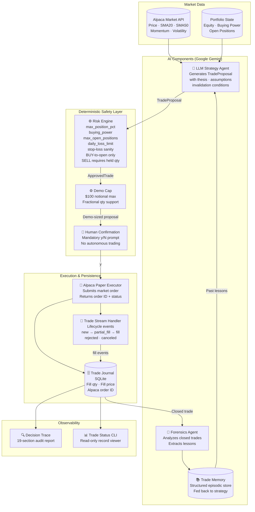

# TradePilot

> An accountable, explainable, human-in-the-loop AI trading assistant for Alpaca paper trading.

---

## Problem

Large language models can reason about markets, generate plausible-sounding theses, and propose trade actions — but they cannot be trusted to control execution directly. An LLM that directly submits orders:

- May hallucinate confidence, quantities, or risk parameters
- Has no deterministic risk enforcement
- Produces no audit trail explaining _why_ a trade was made
- Cannot be held accountable for what it approved
- Cannot learn from closed trades in a structured way

Letting an LLM "trade" without a safety boundary is not a system — it is a liability.

---

## Solution

TradePilot implements a **strict accountability architecture**. The LLM is a _proposal engine_, not an execution engine. Every step between market data and a filled order is deterministically controlled, logged, and explainable.

```
LLM proposes → Risk Engine validates → Human approves → Alpaca executes → Journal records → Forensics learns
```

No order touches Alpaca without passing all three gates: risk validation, demo cap enforcement, and explicit human confirmation.

---

## What Makes TradePilot Different

### 1. AI proposes. Deterministic code controls risk.

The `LLMStrategyAgent` generates a structured `TradeProposal` via Google Gemini with JSON-mode outputs enforced by a Pydantic schema. The proposal then passes through a purely deterministic `RiskEngine` that checks portfolio exposure, buying power, open position count, daily loss limits, and stop-loss sanity — independent of anything the LLM said.

### 2. Human approval is mandatory. Always.

A `[y/N]` confirmation prompt is shown at the terminal before any order is submitted. Autonomous trading is explicitly disabled. The paper-trading demo requires explicit human confirmation before submitting any order.

### 3. Actual Alpaca execution state is recorded.

The `TradeJournal` (SQLite) records the actual `alpaca_order_id`, `filled_quantity`, and `average_fill_price` returned by Alpaca — not values inferred from the original proposal. The `TradeStreamHandler` updates the journal from real Alpaca lifecycle events (`new`, `partial_fill`, `fill`, `rejected`, `canceled`).

### 4. Every trade has an explainable decision trace.

The `decision_trace` CLI produces a 19-section structured report for any trade, answering: why the trade was proposed, why risk approved it, who confirmed it, what Alpaca actually filled, and what the system has learned.

### 5. Closed trades produce forensic lessons and reusable memory.

The `ForensicsAgent` (Gemini-backed) compares the original thesis against actual outcomes for closed trades and produces a `TradeForensics` report. Lessons are stored as structured `TradeMemory` objects and fed back to the strategy agent on future trades.

---

## Architecture



---

## Multi-Agent System

TradePilot uses two LLM-backed agents and several deterministic components. These are deliberately distinct.

| Component | Type | Role |
|---|---|---|
| `LLMStrategyAgent` | **AI (Gemini)** | Analyzes market snapshot + portfolio + past memories; generates a structured `TradeProposal` with thesis, confidence, assumptions, and invalidation conditions |
| `RiskEngine` | **Deterministic** | Enforces portfolio risk rules; the only component that produces an `ApprovedTrade` — required for execution |
| `AlpacaPaperExecutor` | **Deterministic** | Submits the order to Alpaca paper trading; reads back actual fill data |
| `TradeStreamHandler` | **Deterministic** | Maps Alpaca lifecycle events to `TradeRecord` state transitions; writes fill data to the journal |
| `ForensicsAgent` | **AI (Gemini)** | Activated only after a trade is confirmed closed; compares the original thesis against actual outcomes and produces a structured `TradeForensics` report |
| `MemoryStore` | **Deterministic** | Stores and retrieves `TradeMemory` objects from SQLite, ordered by evidence count and confidence |

The `RiskEngine` is intentionally not an LLM component. It uses no language model. Its decisions are reproducible, auditable, and cannot be overridden by a model's output.

---

## Explainable Decision Trace

Run `uv run python -m tradepilot.decision_trace <TRADE_ID>` to generate a complete audit report for any trade in the journal.

The 19-section trace covers:

| # | Section | What it answers |
|---|---|---|
| 1 | Market Data / Evidence | What market conditions existed at proposal time |
| 2 | Strategy Decision | What action the AI proposed |
| 3 | Confidence | How confident the model was |
| 4 | Thesis | The AI's written reasoning |
| 5 | Assumptions | What had to be true for the trade to work |
| 6 | Invalidation Conditions | What would have proven the thesis wrong |
| 7 | Risk Decision | Whether the RiskEngine approved and why |
| 8 | Stop Price | Derived from invalidation conditions |
| 9 | Position Sizing (strategy proposal) | Qty at snapshot price |
| 10 | Demo Sizing ($100 cap) | How the cap was applied |
| 11 | Human Confirmation | Who approved execution |
| 12 | Client Order ID | TradePilot `trade_id` = Alpaca `client_order_id` |
| 13 | Alpaca Order ID | Alpaca's own UUID |
| 14 | Order Status | Live status from Alpaca |
| 15 | Submitted Quantity | Demo-capped qty sent to Alpaca |
| 16 | Execution Result | Actual filled qty, fill price, fill notional from Alpaca |
| 17 | Position / Outcome | Open or closed with entry/exit |
| 18 | Forensics Result | Pending (open) or lesson (closed) |
| 19 | Memory / Lesson | What the system learned and fed back |

**The five questions the trace answers:**

- **Why did TradePilot make this trade?** → The AI's thesis (section 4)
- **Why was it allowed?** → RiskEngine verdict + demo cap (sections 7, 10)
- **Who approved it?** → Human operator at the terminal (section 11)
- **What happened at Alpaca?** → Actual fill from the execution result (section 16)
- **What did the system learn?** → Forensics + memory (sections 18–19)

---

## Safety Architecture

| Rule | Implementation |
|---|---|
| **Paper trading only** | `alpaca_paper_trade: bool = True` in config; `AlpacaPaperExecutor` targets the Alpaca paper endpoint only |
| **ApprovedTrade boundary** | `executor.execute()` accepts only an `ApprovedTrade` — a type only `RiskEngine.evaluate()` can produce when status is `APPROVED` |
| **Deterministic risk checks** | Five independent checks: `max_position_pct`, `buying_power`, `max_open_positions`, `daily_loss_limit`, stop-loss direction |
| **$100 demo notional cap** | `apply_demo_sizing()` scales qty so `qty × price ≤ $100` before the order reaches the executor |
| **Human confirmation** | `input("[y/N]")` prompt in `paper_trade_demo.py`; `'n'` aborts with no order submitted |
| **BUY-to-open only** | `RiskEngine` rejects SELL if no long position is held for the symbol |
| **SELL-to-close only** | `RiskEngine` rejects SELL quantity exceeding held long position |
| **No autonomous trading** | No scheduler, no event loop, no automated trigger in any source file |
| **No live trading** | No live Alpaca endpoint is ever configured or called |

---

## Real Paper Trading Demonstration

TradePilot has executed one real paper trade on Alpaca during development.

| Field | Value |
|---|---|
| Symbol | PLTR |
| Action | BUY |
| Strategy | Bullish — price ($186.24) above SMA20 ($171.03) and SMA50 ($143.74), positive momentum |
| Requested qty | 0.5369 shares |
| Demo cap applied | $100.00 |
| Submitted qty | 0.5369 shares |
| **Actual filled qty** | **0.5369 shares** |
| **Actual fill price** | **$184.61** (Alpaca average fill) |
| **Fill notional** | **$99.12** |
| Snapshot price | $186.24 (market moved −$1.63 between proposal and fill) |
| Status | FILLED |
| Position | OPEN (not yet closed) |
| Client Order ID | `b6e16912-ee7e-47c6-a51b-a663064adaab` |
| Alpaca Order ID | `e3173016-c4fb-4208-ba0d-b99f425d417b` |
| Submitted at | 2026-08-31 13:23:01 UTC |

All fill values are sourced from Alpaca's order response — not inferred from the proposal.

> **No API keys or secrets appear in this repository. See `.env.example` for the required variable names.**

---

## Forensics and Memory

### Live PLTR Trade — Forensics Intentionally Pending

The PLTR position is currently **open**. Forensics only runs after a position is confirmed closed — specifically, after the Alpaca position quantity reaches zero and a real exit price is available. Until then, `decision_trace` correctly reports:

```
Position not yet closed -- forensics will run after exit is confirmed.
```

No lesson has been fabricated for PLTR.

### Offline Forensics Demo

A separate offline demonstration is available:

```bash
uv run python -m tradepilot.forensics_demo
```

This demo simulates a complete closed trade and shows the `ForensicsAgent` analyzing the outcome, extracting assumptions, and producing a structured lesson. It does not interact with the live journal or any Alpaca order.

### Memory Architecture

`TradeMemory` objects are stored in the same SQLite database (`data/tradepilot.db`). Retrieval is deterministic — ordered by evidence count then confidence — not by semantic vector similarity. This is an intentional MVP design choice documented under [Limitations](#limitations).

---

## Testing

```
118 tests passed, 1 warning
```

The warning is an existing upstream deprecation in the `websockets` package (`websockets.legacy`). It is not introduced by TradePilot and does not affect functionality.

**Test coverage by module:**

| Test file | What it covers |
|---|---|
| `test_risk_engine.py` | All deterministic risk rules including BUY/SELL enforcement |
| `test_execution.py` | Executor safety, lifecycle events, fill accumulation, P&L gating |
| `test_paper_trade_demo.py` | Demo sizing, cap enforcement, market-session safety |
| `test_decision_trace.py` | All 19 sections, lookup strategies, label correctness |
| `test_trace_status_consistency.py` | `trade_status` and `decision_trace` share the same record |
| `test_llm_strategy.py` | LLM strategy agent with mocked Gemini responses |
| `test_forensics.py` | Forensics agent with mocked Gemini responses |
| `test_memory.py` | TradeJournal and MemoryStore round-trips |
| `test_market_data.py` | Market snapshot fetching |
| `test_alpaca_integration.py` | Alpaca client integration |
| `test_clock.py` | Market session safety layer |
| `test_strategy.py` | Deterministic baseline strategy agent |
| `test_trade_status.py` | Read-only trade status CLI |

---

## Project Structure

```
tradepilot/
├── agents/
│   ├── strategy.py          # Abstract StrategyAgent base class
│   ├── llm_strategy.py      # Google Gemini strategy agent (structured output)
│   └── forensics.py         # Google Gemini forensics agent
├── alpaca/
│   ├── client.py            # Alpaca client factory
│   ├── execution.py         # AlpacaPaperExecutor (paper-only)
│   ├── market_data.py       # Market snapshot fetcher
│   ├── portfolio.py         # Portfolio state fetcher
│   ├── trade_stream.py      # Lifecycle event handler
│   └── clock.py             # Market session safety check
├── core/
│   ├── models.py            # All Pydantic data models
│   ├── risk_engine.py       # Deterministic RiskEngine
│   ├── orchestrator.py      # Orchestrator (wires components)
│   └── config.py            # Settings (pydantic-settings / .env)
├── memory/
│   ├── journal.py           # TradeJournal (SQLite)
│   └── store.py             # MemoryStore (SQLite)
├── decision_trace.py        # 19-section explainable trace CLI
├── trade_status.py          # Read-only trade status CLI
├── paper_trade_demo.py      # Interactive demo (main entry point)
├── forensics_demo.py        # Offline forensics demonstration
└── ai_strategy_demo.py      # Standalone strategy agent demo

tests/                       # 118 tests across 13 test files
data/
└── tradepilot.db            # SQLite journal + memory store (gitignored)
```

---

## Setup

**Requirements:** Python 3.12+, [uv](https://github.com/astral-sh/uv)

```bash
# Clone and install
git clone <repo>
cd TradePilot
uv sync

# Configure credentials
cp .env.example .env
# Edit .env and fill in your values (see below)
```

**`.env` configuration:**

```env
# Alpaca paper trading credentials
# Get these from: https://app.alpaca.markets/paper-trading
ALPACA_API_KEY=your_alpaca_paper_api_key
ALPACA_SECRET_KEY=your_alpaca_paper_secret_key

# Google Gemini API key
# Get this from: https://aistudio.google.com/apikey
GEMINI_API_KEY=your_gemini_api_key

# Optional: override risk limits (defaults shown)
MAX_POSITION_PCT=0.1
MAX_RISK_USD=10000.0
MAX_OPEN_POSITIONS=5
DAILY_LOSS_LIMIT=2000.0
```

> Use Alpaca **paper trading** credentials only. Never configure live trading credentials.

**Run tests:**

```bash
uv run pytest
```

---

## Running the Demo

### Interactive Paper Trade Demo

```bash
uv run python -m tradepilot.paper_trade_demo PLTR
```

This command:
1. Fetches the current PLTR market snapshot from Alpaca
2. Fetches your paper portfolio state
3. Retrieves any stored trade memories for PLTR
4. Sends snapshot + portfolio + memories to the Gemini strategy agent
5. Validates the proposal through the deterministic RiskEngine
6. Applies the $100 demo notional cap
7. Shows the market session status (warns if market is closed)
8. Displays the full proposal and asks `[y/N]` for confirmation
9. On `y`: submits to Alpaca paper trading and records the fill in the journal

### Read-Only Trade Status

```bash
uv run python -m tradepilot.trade_status <TRADE_ID>
```

Example:
```bash
uv run python -m tradepilot.trade_status b6e16912-ee7e-47c6-a51b-a663064adaab
```

Displays trade ID, thesis ID, symbol, action, requested qty, filled qty, average fill price, execution status, Alpaca order ID, and entry timestamp. P&L is shown only for closed trades.

### Explainable Decision Trace

```bash
uv run python -m tradepilot.decision_trace <TRADE_ID>
```

Accepts either the TradePilot `trade_id` (= Alpaca `client_order_id`) or the Alpaca `order_id` — both resolve to the same record.

### Offline Forensics Demo

```bash
uv run python -m tradepilot.forensics_demo
```

---

## Design Decisions

### Why is the Risk Engine deterministic?

LLM outputs are stochastic. A model might propose a position 50× larger than the portfolio. Deterministic risk enforcement means the rules cannot be reasoned around, hallucinated past, or accidentally disabled by a model update.

### Why Pydantic schemas throughout?

Every component boundary — `TradeProposal`, `ApprovedTrade`, `RiskDecision`, `ExecutionResult`, `TradeRecord`, `TradeForensics`, `TradeMemory` — is a validated Pydantic model. This prevents type confusion between components and makes the LLM's structured output verifiable before it reaches any safety-critical path.

### Why does execution require `ApprovedTrade`?

`ApprovedTrade` is a type-level contract. `AlpacaPaperExecutor.execute()` only accepts `ApprovedTrade`, which can only be produced by `RiskEngine.evaluate()` when the result is `APPROVED`. You cannot call `execute()` with a raw `TradeProposal`. The type system enforces the safety boundary.

### Why SQLite for the journal?

SQLite is zero-dependency, file-based, and sufficient for a single-process hackathon MVP. The journal schema stores each `TradeRecord` as a JSON blob with indexed columns for `trade_id`, `symbol`, and `action`. Upgrading to a client-server database would require changing only `journal.py`.

### Why is human confirmation mandatory?

Autonomous trading is not the goal of this project. The demo is designed to show what the system _would_ do, with a human making the final call. The `[y/N]` prompt is not a feature that can be toggled off — it is the architecture.

---

## Limitations

- **No autonomous trading.** Every order requires explicit human approval at the terminal. There is no scheduler, webhook, or event-driven trigger.
- **Forensics requires a confirmed close.** The `ForensicsAgent` only runs after the Alpaca position quantity reaches zero and a real exit price is available. Open trades show "forensics pending."
- **Memory retrieval is deterministic, not semantic.** `MemoryStore.retrieve_memories()` retrieves by exact symbol match, ordered by evidence count and confidence. There is no embedding-based vector search. This is an intentional MVP design choice.
- **Single-symbol, single-trade demo.** The interactive demo processes one symbol per invocation. Portfolio-level multi-position management is not implemented.
- **No live trading.** TradePilot only targets the Alpaca paper trading endpoint. Live trading is not supported and is not the intent.
- **Hackathon MVP.** This is not production financial infrastructure. It has no authentication layer, no multi-user support, no rate limiting, and no failover.

---

## Demo Story (2–3 minutes)

**Setup (30 seconds)**
> "TradePilot is an accountable AI trading assistant. The LLM proposes, deterministic code controls risk, and a human approves. Nothing is autonomous."

**Step 1 — Strategy (30 seconds)**
> Run `paper_trade_demo PLTR`. The Gemini agent produces a structured thesis: price above SMA20 and SMA50, positive momentum, bullish alignment. Confidence: 75%.

**Step 2 — Risk (20 seconds)**
> The RiskEngine validates: exposure within 10% limit, buying power sufficient, position count under 5, daily loss not exceeded. Status: APPROVED.

**Step 3 — Demo cap (10 seconds)**
> The $100 cap is applied. At ~$186/share, the system computes max ~0.537 fractional shares.

**Step 4 — Human confirmation (20 seconds)**
> The terminal shows the full proposal and asks `[y/N]`. The operator types `y`. The order is submitted.

**Step 5 — Execution (20 seconds)**
> Alpaca fills 0.5369 shares at $184.61 (the market moved $1.63 between proposal and fill). The journal records actual fill data, not the proposed price.

**Step 6 — Trace (30 seconds)**
> Run `decision_trace b6e16912-...`. Show the 19-section report answering all five accountability questions. Point to section 16 (execution result) vs section 9 (strategy proposal) — two different prices, clearly labelled.

**Step 7 — Status (10 seconds)**
> Run `trade_status b6e16912-...`. Clean read-only view: FILLED, 0.5369 shares @ $184.61, position OPEN.

---

## Disclaimer

TradePilot is a **hackathon project** built for educational and demonstration purposes.

- It uses **Alpaca paper trading only**. No real money is involved.
- It is **not financial advice**.
- It is **not production trading infrastructure**.
- Past paper trade results (including the PLTR demonstration) are not predictive of any future outcome.
- The AI strategy agent is a language model producing probabilistic outputs. It can be wrong.

Do not use this system with live trading credentials.
